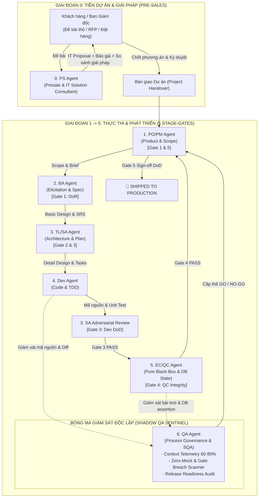

# TC IT Agent Framework — Khung Vận Hành Đa Tác Tử Doanh Nghiệp (Multi-Agent Enterprise v3.0 (Web Dashboard & Full Spec-Kit Suite))

> **TC IT Agent** là bộ khung điều phối AI Agent toàn diện dành cho phát triển phần mềm doanh nghiệp, được đúc kết từ tinh hoa của hai phương pháp luận hàng đầu: **GitHub Spec Kit** (Đặc tả chính xác) và **BMad Method** (Tranh biện đối kháng đa tác tử & kiểm thử đa tầng).  
> **Phiên bản 3.0 Enterprise**: Bổ sung **Software Quality Assurance Lead & Shadow QA Inspector (`qa.md`)**, cơ chế **Bóng ma giám sát độc lập (Shadow QA Sentinel & Real-time Audit)**, giám sát trí nhớ **Context Telemetry (ngưỡng 60% – 80% Safe Context Evacuation)**, chốt chặn cơ học **Độ phủ trường biểu mẫu Wireframe (`audit_wireframe_fields.py` $\ge 80\%$)**, triệt tiêu Mock ngầm trên Client (**Zero-Mock Discipline**), đối soát CSDL thật (**Deep DB State Verification**), chuẩn hóa **5 Hành vi Entity Lifecycle trên Frontend**, và kịch bản điều phối báo cáo tiến độ PO/PM hàng ngày (`send_po_report.py`).

---

## 1. Cấu Trúc Toàn Diện Gói TC IT Agent Framework

```text
TC IT Agent/
├── loop                          # Bảng điều khiển 1 chạm TUI & Shortcut CLI điều khiển vòng lặp AI (Hỗ trợ ./loop ui mở Web Dashboard)
├── dashboard/                    # [MỚI V3.0] Live Realtime Agent Orchestrator Web Dashboard (http://127.0.0.1:8420)
│   ├── api/server.py             # FastAPI & SSE Streaming Server cho DAG, Human Gates & Model Config
│   ├── core/dag_engine.py        # Động cơ DAG đồ thị phụ thuộc, Topological Sort Wave & Critical Path
│   ├── core/live_runner.py       # Cầu nối thực thi trực tiếp Stage-Gate, Telemetry & QA Sentinel
│   └── static/index.html         # Giao diện Web hiện đại, Stepper 6 giai đoạn, Live Logs & Model Matrix
├── engine/                       # Bộ máy thực thi Vòng lặp Tự trị & E2E Macro Pipeline
│   ├── tc-loop.py                # Động cơ tự trị độc lập (Native Tmux, Fresh Context, Deterministic Gates)
│   └── policy.toml               # Cấu hình chính sách vận hành dự án (timeout, blast radius, verify commands)
│
├── .agents/                      # 7 Persona tác tử chuyên trách toàn vòng đời dự án
│   ├── ps.md                     # Presale & IT Solution Consultant (Proposal, WBS, TCO, RFP)
│   ├── po-pm.md                  # Product Owner & Project Manager (Scope, Roadmap, Gate 1 & 5)
│   ├── ba.md                     # Senior Business Analyst (Khơi gợi 9D, Basic Design, SRS 7 mục)
│   ├── techlead-sa.md            # Software Architect & Tech Lead (Detail Design, Gate 2 & 3 Review)
│   ├── dev.md                    # Senior Full-Stack Developer (5 Entity Lifecycle, 5 UX States, TDD)
│   ├── ec.md                     # Edge-Case Hunter & QC Specialist (Gate 4, Pure Black-Box, Deep DB Assertion)
│   └── qa.md                     # [MỚI] Software Quality Assurance & Shadow QA Inspector (Gate 1-5, Context Telemetry)
│
├── docs/                         # Tài liệu tiêu chuẩn và hướng dẫn kiến trúc
│   ├── HUONG_DAN_SU_DUNG_AUTONOMOUS_LOOP.md # Hướng dẫn vận hành Vòng lặp Tự trị & Pipeline
│   └── CROSS_SURFACE_AND_4TIER_TESTING_STANDARD.md # Tiêu chuẩn kiểm soát bề mặt & test 4 tầng
│
├── skills/                       # Thư viện kỹ năng chuẩn hóa 100% theo tiền tố Role & Workflows
│   ├── ps-proposal/              # [PS] Soạn thảo IT Technical Proposal chuyên nghiệp
│   ├── ps-estimate/              # [PS] Bóc tách Man-Month & dự toán TCO hạ tầng Cloud
│   ├── ps-solution/              # [PS] So sánh Trade-off các phương án kiến trúc
│   ├── ps-rfp/                   # [PS] Thẩm định hồ sơ thầu & báo cáo tính khả thi
│   ├── po-scope/                 # [PO] Sàng lọc yêu cầu & Ma trận tác động lan truyền
│   ├── po-scope-triage/          # [PO] Sàng lọc phạm vi, phân loại P1/P2/P3 & Cross-Surface Matrix
│   ├── po-roadmap/               # [PO] Quản trị Master Roadmap, Milestones & Epics
│   ├── po-gate/                  # [PO] Biên bản nghiệm thu DoD & Phê duyệt xuất xưởng (Gate 5)
│   ├── po-party/                 # [PO] Triệu tập hội nghị bàn tròn đa tác tử (Party Mode)
│   ├── po-course/                # [PO] Nắn dòng dự án & phát hiện trôi dạt yêu cầu (Anti-Drift)
│   ├── po-issues/                # [PO] Đồng bộ danh sách tasks thành GitHub Issues
│   ├── bmad-party-mode/          # [PO/PM] Điều phối Hội nghị Bàn tròn Đa tác tử giải quyết bài toán khó
│   ├── bmad-correct-course/      # [PO/PM] Nắn dòng và chống trôi dạt mục tiêu dự án
│   ├── xong/                     # [PO] Nghiệm thu toàn diện DoD, cập nhật Living Docs & đóng spec xuất xưởng
│   ├── ba-elicit/                # [BA] 9 kỹ thuật khơi gợi nghiệp vụ chuyên sâu (5 Whys...)
│   ├── ba-design/                # [BA] Soạn thảo Thiết kế Cơ sở (Kihon Sekkei) & Living Docs
│   ├── ba-srs/                   # [BA] Soạn thảo đặc tả SRS 7 mục khép kín (REQ-, BR-)
│   ├── ba-trace/                 # [BA] Kiểm toán ma trận truy vết khép kín REQ ↔ BR ↔ DB ↔ Test
│   ├── ba-clarify/               # [BA] Đặt tối đa 5 câu hỏi trọng tâm làm rõ điểm nghẽn (Cấm đoán mò)
│   ├── ba-docx/                  # [BA] Xuất bản tài liệu sang định dạng Word DOCX trình ký
│   ├── bmad-advanced-elicitation/# [BA] Bộ 9 kỹ thuật khơi gợi nghiệp vụ chuyên sâu
│   ├── traceability-auditor/     # [BA/SA] Kiểm toán ma trận truy vết khép kín, bắt mã mồ côi
│   ├── sa-design/                # [SA] Thiết kế kỹ thuật chi tiết (ERD, OpenAPI, Sequences)
│   ├── sa-plan/                  # [SA] Lập kế hoạch kiến trúc kỹ thuật theo Epic (plan.md)
│   ├── sa-guard/                 # [SA] Vệ binh ranh giới Clean Architecture & dọn rác thư mục
│   ├── clean-arch-guard/         # [SA] Vệ binh kiến trúc sạch quét AST & ranh giới namespace
│   ├── sa-review/                # [SA] Rà soát mã nguồn đối kháng khắt khe (Gate 3)
│   ├── sa-analyze/               # [SA] Phân tích tính nhất quán chéo 3 chiều (Gate 2)
│   ├── sa-refactor/              # [SA] Quét dự án cũ (Chỉ đọc) & Đề xuất giải pháp Refactor
│   ├── chot/                     # [SA] Chốt quyết định kiến trúc thành ADR & cập nhật open-questions.md
│   ├── dev-tasks/                # [Dev] Phân rã checklist công việc theo 5 Entity Lifecycle & 5 UX States
│   ├── dev-code/                 # [Dev] Lập trình thực thi bám sát task có kiểm chứng [x]
│   ├── dev-uiux/                 # [Dev] Chuẩn hóa giao diện 5 trạng thái UX qua <Async>
│   ├── dev-unit/                 # [Dev] Viết Unit Test TDD cho toàn bộ Business Rules
│   ├── dev-converge/             # [Dev] Quét hội tụ mã nguồn và sinh bổ sung tasks còn thiếu
│   ├── speckit-autopilot/        # [Dev/PO] Trục cao tốc tự động hóa toàn trình Epic (Subagent Isolation)
│   ├── speckit-delta/            # [SA/Dev] Cập nhật Change Request phi phá hủy (Non-destructive)
│   ├── speckit-uiux/             # [Dev] Chuẩn hóa 5 trạng thái UX & chụp ảnh Visual QA Playwright
│   ├── speckit-converge/         # [Dev/SA] Quét mức độ hội tụ mã nguồn so với đặc tả sống
│   ├── ec-hunt/                  # [EC] Săn tìm lỗi biên, kịch bản ngoại lệ & dữ liệu cực hạn
│   ├── ec-e2e/                   # [EC] Tự động sinh kịch bản Playwright E2E Black-box từ AC
│   ├── bmad-qa-generate-e2e-tests/# [EC] Tự động sinh kịch bản Playwright E2E từ AC & User Journey
│   ├── ec-fuzz/                  # [EC] Fuzzing bảo mật & kiểm tra phân quyền RBAC/IDOR
│   ├── rbac-permission-fuzzer/   # [EC] Fuzzing ma trận phân quyền 3D Scoped RBAC, chống leo thang đặc quyền
│   ├── ec-contract/              # [EC] Kiểm định hợp đồng API Consumer-Provider, chống Breaking Changes
│   ├── ec-load/                  # [EC] Kiểm thử tải và stress testing (k6/autocannon), tìm điểm sập
│   ├── ec-chaos/                 # [EC] Kiểm thử hỗn loạn (Chaos Engineering), bơm lỗi DB/Queue/Timeout
│   ├── ec-mutation/              # [EC] Kiểm thử đột biến (Mutation Testing), thử lửa chất lượng test
│   ├── pr-review-guard/          # [SA/Dev] Gác cổng Task DoD và PR theo 6 trục (Wireframe coverage >= 80%)
│   ├── ec-test/                  # [EC] Điều phối bộ kiểm thử 4 tầng khép kín (Gate 4 & Deep DB State)
│   ├── qa-gate-audit/            # [QA] [MỚI] Kiểm toán độc lập 5 Cổng Chất Lượng Stage-Gate (Gate 1 - Gate 5)
│   ├── qa-shadow-sentinel/       # [QA] [MỚI] Bóng ma kiểm toán độc lập: Token Context 60%-80% & Zero-Mock
│   ├── handoff/                  # [ALL] [ECC] Bàn giao ca làm việc & xuất checkpoint an toàn khi context >= 70%
│   └── wf-*/                     # [Workflows] Các quy trình thực thi chuẩn (autopilot, delta, pr-review, audit...)
│
├── scripts/                      # Kịch bản tự động hóa & chốt chặn chất lượng
│   ├── guard-rails.sh            # Chốt chặn toán học tĩnh 8 tầng (chống ảo giác, rò rỉ kiến trúc & Zero-Mock)
│   ├── block-no-verify.py        # [ECC] Chốt chặn cứng ngăn chặn AI Agent bypass hooks (--no-verify, -n)
│   ├── fact-forcing-guard.py     # [ECC] Ép khai báo sự thật (Fact-Sheet) trước khi can thiệp tệp Tier-1 Domain/DB
│   ├── memory-vault.py           # [ECC] Quản trị kho tri thức bền vững & bàn giao ca làm việc (.memory/)
│   ├── install-hooks.sh          # [ECC] Trình cài đặt tự động Git Hooks (pre-commit, commit-msg, pre-push)
│   ├── qa-shadow-sentinel.sh     # [MỚI] Script Shadow QA kiểm toán thời gian thực (Context Telemetry, Gate 2)
│   ├── audit_wireframe_fields.py # [MỚI] Chốt chặn cơ học kiểm tra độ phủ trường biểu mẫu (Controls >= 80%)
│   ├── send_po_report.py         # [MỚI] Kịch bản tự động dispatch email báo cáo tiến độ PO/PM
│   └── render_srs_html.py        # Kịch bản render tài liệu SRS sang HTML báo cáo trực quan
│
├── workflows/                    # Bộ quy trình vận hành liên Agent
│   ├── wf-presale.md             # Đề bài thô -> Thẩm định khả thi -> Proposal & Báo giá
│   ├── wf-kickoff.md             # Hợp đồng duyệt -> Basic Design (Walking Skeleton) & Roadmap
│   ├── wf-autopilot.md           # Toàn trình tự động 1 Epic: Spec -> Plan -> Code -> Test -> QA -> Ship
│   ├── wf-pr-review.md           # Kỷ luật gác cổng Task DoD, Pull Request & Stage-Gate 3 & 4
│   ├── wf-delta.md               # Tiếp nhận Change Request: Tài liệu đi trước, Code theo sau
│   ├── wf-uiux.md                # Chuẩn hóa 5 trạng thái UX & Chụp ảnh Visual QA Playwright
│   └── wf-audit.md               # Kiểm toán hệ thống toàn diện trước ngày phát hành (QA & SA)
│
├── templates/                    # Bộ biểu mẫu nghiệp vụ & kỹ thuật chuẩn hóa
│   ├── TEMPLATE-it-proposal.md   # Mẫu IT Technical Proposal chuẩn trình C-Level / Khách hàng
│   ├── TEMPLATE-cost-estimation.md # Mẫu bảng tính Man-Month, chi phí Cloud & TCO
│   ├── TEMPLATE-basic-design.md  # Mẫu Thiết kế Cơ sở (Kihon Sekkei)
│   ├── TEMPLATE-task-review-checklist.md # Mẫu checklist tự rà soát cho từng Task
│   ├── TEMPLATE-pull-request.md  # Mẫu Pull Request theo 6 trục kiểm soát & 2 cổng duyệt
│   ├── pull_request_template.md  # Template Pull Request dùng sẵn cho GitHub
│   ├── TEMPLATE-detail-design-erd.md # Mẫu Thiết kế CSDL, Data Dictionary & ERD
│   ├── TEMPLATE-detail-design-api.md # Mẫu Hợp đồng API RESTful chuẩn
│   ├── TEMPLATE-SRS-7-muc.md     # Mẫu đặc tả phần mềm 7 mục khép kín
│   ├── TEMPLATE-yeu-cau-thay-doi.md # Mẫu phiếu yêu cầu thay đổi (CR)
│   ├── AGENTS.enterprise.template.md # Bộ luật điều hành AI Agent trong dự án (7 Personas)
│   ├── constitution.template.md  # Mẫu Hiến pháp chất lượng kỹ thuật
│   └── adapters/                 # Bộ chuyển đổi đa nền tảng (.cursorrules, CLAUDE.md, etc.)
│
├── template-workspace/           # Cấu trúc thư mục mẫu chuẩn mực sẵn sàng nhân bản
├── docs/                         # Báo cáo và tài liệu hướng dẫn
│   ├── TC_IT_AGENT_MASTER_PRD.md # Tài liệu PRD & Kế hoạch tổng thể v2.0
│   ├── KE_HOACH_TAI_CAU_TRUC_TC_IT_AGENT.html # Báo cáo giao diện trực quan hiện đại
│   └── BAO_CAO_TEAM_AGENT_VA_WORKFLOW.html # Báo cáo phân tích chuyên sâu
│
├── install.sh                    # Trình cài đặt & Cập nhật Universal tự động (v2.4 Enterprise)
└── README.md                     # Cẩm nang tài liệu này
```

---

## 2. Vận Hành Vòng Lặp Tự Trị AI Bằng Bảng Điều Khiển 1 Chạm (`./loop`)

Khác biệt lớn nhất của **TC IT Agent Enterprise** là **Autonomous Loop Engine** — cho phép AI Agent tự động thực thi tuần tự các task kỹ thuật mà **không cần con người phải ngồi canh từng câu lệnh chat**.

```bash
# Mở Bảng điều khiển Terminal TUI tương tác:
./loop
```

### Các tính năng vượt trội:
1. **Triết lý No-LLM-in-the-control-loop**: Engine Python bên ngoài (`engine/tc-loop.py`) điều phối tiến trình, kiểm tra số lần retry, đo lường blast radius và kích hoạt verify gates. LLM chỉ thuần túy nhận prompt thực thi task cụ thể.
2. **Fresh Context per session**: Mỗi task chạy trong một process CLI riêng biệt (`agy` hoặc `claude`), ngăn chặn hoàn toàn hiện tượng tràn bộ nhớ ngữ cảnh và trôi dạt yêu cầu (Context Drift).
3. **Chạy ngầm âm thầm qua Tmux (Background Daemon)**: Bấm `[2]` để Agent chạy ngầm trong session `tc-loop`. Bạn có thể đóng cửa sổ terminal hoặc làm việc khác. Bấm `[3]` hoặc gõ `./loop view` để kết nối xem Agent đang gõ phím theo thời gian thực.
4. **Deterministic Verify Gate & Atomic Git Commit**: Chỉ khi 100% các lệnh kiểm thử trong `engine/policy.toml` vượt qua (0 lỗi biên dịch, tests pass), task mới được tick `[x]` và commit git nguyên tử ngay cùng một transaction.
5. **Macro Pipeline Toàn Trình (PO -> BA -> SA -> Dev -> QC -> QA)**: Bấm `[7]` hoặc gõ `./loop pipeline`, hệ thống tự động quét toàn bộ backlog trong `BACKLOG.md` (hoặc `backlog/BACKLOG.md`), tự động phân tích tính năng mới vs change request, triệu hồi các Agent tương ứng và tự động chạy khép kín đến khi hoàn tất 100%.

> 📖 **Xem hướng dẫn chi tiết**: [docs/HUONG_DAN_SU_DUNG_AUTONOMOUS_LOOP.md](docs/HUONG_DAN_SU_DUNG_AUTONOMOUS_LOOP.md)

---

## 3. Các Đột Phá Mới Tại Phiên Bản v2.4 Enterprise

### 1. QA Agent & "Bóng Ma Giám Sát" (`qa.md` & `qa-shadow-sentinel.sh`)
- **Cách ly ngữ cảnh (Context Isolation)**: QA hoạt động trên tiến trình ngầm độc lập, không bị lây nhiễm suy thoái ngữ cảnh từ Dev hoặc QC.
- **Giám sát Trí nhớ Context Telemetry**: Đo lường trực tiếp tokens từ transcript log:
  * *Vùng Vàng (60% / 80k tokens)*: Cảnh báo sớm nhắc nhở dứt điểm task.
  * *Vùng Đỏ (80% / 120k tokens)*: Báo động đỏ, khóa lệnh, kích hoạt Quy trình 3 bước giải phóng an toàn (**Safe Context Evacuation**: Checkpoint $\rightarrow$ Commit code $\rightarrow$ `/compact` hoặc mở Clean Session).
- **Chốt chặn Gate 2 Breach**: Cắt luồng ngay lập tức nếu Dev sửa code khi chưa có `plan.md` hoặc `tasks.md`.
- **Zero-Mock Scanner**: Quét Git diff bắt các bẫy mock ngầm (`fakeItem`, dummy fallback trong khối `catch`).

### 2. Kiểm Toán Cơ Học Độ Phủ Trường Biểu Mẫu (`audit_wireframe_fields.py`)
- Tự động so sánh số lượng interactive controls (`input`, `select`, `textarea`, `FormField`...) giữa Wireframe HTML Basic Design gốc và Frontend Component.
- Tỷ lệ controls trên giao diện bắt buộc phải $\ge 80\%$. Nghiêm cấm cắt xén trường form để làm đẹp bài test.

### 3. Kỷ Luật Pure Black-Box Testing & Deep DB State Verification (QC)
- **Zero-Mock QC**: QC tiếp cận hệ thống hoàn toàn mù code nội bộ. Tuyệt đối cấm dùng `page.route()` mớm dữ liệu, cấm inject mock token.
- **Deep DB State Verification**: Mọi thao tác Mutation trên giao diện (Tạo mới, Cập nhật, Đổi trạng thái) bắt buộc phải có câu lệnh SQL query trực tiếp CSDL thật để xác minh dòng dữ liệu đã thực sự được lưu. Chặn đứng lỗi "rỗng ruột dữ liệu" (Data Hollow Bug).
- **Zero-Shallow Assertions**: 100% buttons, links, search forms phải có test kích hoạt click, submit và router navigation thật.

### 4. Chuẩn Hóa 5 Hành Vi Entity Lifecycle trên Frontend
Mọi phân hệ nghiệp vụ có dữ liệu bắt buộc phải bóc tách đủ 5 hành vi tương ứng theo sơ đồ định tuyến và phân quyền:
- `[FE-LIST]`: Danh sách hiển thị, bộ lọc đa tiêu chí, phân trang kèm 5 UX states (`<Async>`).
- `[FE-DETAIL]`: Màn hình xem chi tiết bản ghi (Read-only, masking dữ liệu nhạy cảm).
- `[FE-CREATE]`: Form tạo mới đầy đủ 100% trường dữ liệu theo Wireframe HTML gốc.
- `[FE-EDIT]`: Form chỉnh sửa bản nháp có kiểm tra quyền Owner và Optimistic Locking.
- `[FE-STATUS]`: Luồng chuyển đổi trạng thái (Gửi duyệt, Thu hồi, Đóng hồ sơ, Soft-delete).

---

## 4. Hướng Dẫn Tích Hợp Vào Các Dự Án IT Khác

### Trường Hợp 1: Tích Hợp Vào Dự Án Mới Tinh (Greenfield Project)

Dành cho khi bạn bắt đầu một dự án mới hoàn toàn từ đầu (chưa có code):

1. **Chạy lệnh cài đặt**:
   ```bash
   # Di chuyển vào thư mục TC IT Agent và chạy:
   ./install.sh /duong-dan/toi/du-an-moi --name "TenDuAnMoi" --all
   ```
2. **Hệ thống sẽ tự động**:
   - Thiết lập cấu trúc cây thư mục sạch chống rác (`docs/`, `backlog/`, `specs/`, `src/`, `tests/`).
   - Cài đặt 7 Persona vào `.agents/` và toàn bộ kỹ năng `skills/`, `workflows/`, `scripts/`.
   - Kích hoạt adapters cho mọi IDE: Cursor (`.cursorrules`), Windsurf (`.windsurfrules`), Claude Code (`CLAUDE.md`).
   - Tạo sẵn file script cập nhật 1 chạm `update-tc-agent.sh`.
3. **Quy trình bắt đầu làm việc**:
   - **Nếu đang đấu thầu/làm giải pháp**: Mở chat gõ `/wf-presale de-bai.txt` để **PS Agent** làm Proposal & Báo giá.
   - **Nếu đã chốt dự án**: Gõ `/wf-kickoff` để **PO/PM** và **BA** dựng Basic Design (Kihon Sekkei) và Master Roadmap.
   - **Khi bắt đầu làm tính năng**: Gõ `/wf-autopilot specs/EPIC-01` để chạy tự động toàn trình.

---

### Trường Hợp 2: Tích Hợp Vào Dự Án Đang Chạy Dở (Brownfield / Legacy Project)

Dành cho dự án đã có sẵn mã nguồn, đang chạy thực tế mà bạn muốn đưa đội Agent vào vận hành:

1. **Chạy lệnh cài đặt**:
   ```bash
   ./install.sh /duong-dan/toi/du-an-dang-chay --name "TenDuAnHienTai" --all
   ```
   *Lưu ý an toàn*: Script sẽ **tạo thêm** các thư mục tài liệu quản lý còn thiếu (`docs/`, `specs/`, `backlog/`, `.agents/`) và **KHÔNG BAO GIỜ** ghi đè hay làm mất bất kỳ file code hiện có nào của bạn trong `src/`!

2. **Quy trình Quét & Đề Xuất Giải Pháp Refactor An Toàn (Zero Risk)**:
   - **Bước A (Quét Hiện Trạng & Đề Xuất Refactor)**:
     Chạy lệnh:
     ```text
     /wf-refactor
     ```
     ➔ **TL/SA Agent** kích hoạt kỹ năng `sa-refactor` chạy ở **chế độ chỉ đọc (Strictly Read-Only)**:
     - Quét toàn bộ mã nguồn cũ, dependencies, ORM CSDL và điểm nghẽn hiệu năng.
     - **TUYỆT ĐỐI KHÔNG** tự ý sửa, xóa, di chuyển bất kỳ dòng code cũ nào.
     - Tự động sinh bộ tài liệu hoàn chỉnh tại thư mục quản trị:
       + `docs/02-detail-design/AS_IS_SYSTEM_ANALYSIS.md` (Phân tích nợ kỹ thuật hệ thống cũ)
       + `docs/02-detail-design/TO_BE_ARCHITECTURE.md` (Bản vẽ Clean Architecture mục tiêu)
       + `docs/00-presale-proposal/REFACTORING_PROPOSAL.md` (Hồ sơ giải pháp & Báo giá Man-Month)
       + `backlog/REFACTORING_ROADMAP.md` (Lộ trình tái cấu trúc từng bước an toàn)

   - **Bước B (Đảo ngược tài liệu - Reverse Engineering)**:
     Yêu cầu **BA Agent** và **SA Agent**:
     > *"Dựa trên mã nguồn hiện tại trong src/ và database schema, hãy tái tạo lại tài liệu Thiết kế Cơ sở tại docs/01-basic-design/ và Master Roadmap tại backlog/ROADMAP.md."*

   - **Bước C (Phát triển tiếp các tính năng mới hoặc xử lý yêu cầu thay đổi)**:
     - Khi có tính năng mới: Dùng `/wf-autopilot specs/EPIC-XX`.
     - Khi có yêu cầu sửa đổi logic cũ: Dùng `/wf-delta CR-XX` (bảo đảm cập nhật tài liệu trước khi sửa code).

---

## 5. Cơ Chế Nâng Cấp & Đồng Bộ Khi Team Agent Được Cập Nhật

Khi bạn nâng cấp Agent, bổ sung Skill hoặc cải tiến Prompt tại kho nguồn **`TC IT Agent`** này, sau đó đẩy lên Git:

### Cập Nhật 1 Chạm Qua Script `update-tc-agent.sh`
Tại **dự án con** của bạn (ví dụ `MyProject/`):
```bash
# Chỉ cần chạy duy nhất 1 lệnh:
./update-tc-agent.sh
```
*Lệnh này tương đương với: `path/to/TC IT Agent/install.sh . --update`*

#### Điều gì diễn ra khi chạy Update?
- ✅ **Cập nhật mới nhất**: Toàn bộ 7 Personas trong `.agents/`, toàn bộ Kỹ năng trong `skills/`, toàn bộ Quy trình trong `workflows/`, Scripts kiểm toán (`scripts/`) và các rules IDE (`.cursorrules`, `CLAUDE.md`, `.windsurfrules`).
- 🛡️ **BẢO VỆ TUYỆT ĐỐI**: Script **KHÔNG BAO GIỜ** chạm vào mã nguồn (`src/`), dữ liệu tài liệu (`docs/`), kế hoạch (`backlog/`) hay đặc tả (`specs/`) của dự án con.

---

## 6. Chu Trình 7 Tác Tử Toàn Vòng Đời Phần Mềm (Stage-Gate & Shadow QA)



---

## 7. Bảng Tra Cứu Nhanh Lệnh & Quy Trình

| Lệnh Gõ Tắt / Chat | Role Chủ Trì | Tác Vụ Cụ Thể |
| :--- | :--- | :--- |
| **`./loop`** | **Toàn đội** (Loop Engine) | Bảng điều khiển Vòng lặp tự trị, chạy ngầm tmux, E2E Pipeline tự động. |
| **`/wf-presale`** | **`ps`** (Presale) | Lập IT Technical Proposal, tính toán Man-Month và dự toán chi phí TCO Cloud. |
| **`/wf-kickoff`** | **`po-pm`** (PO/PM) | Khởi tạo Basic Design (Walking Skeleton) và Master Roadmap ban đầu. |
| **`/wf-refactor`** | **`sa`** (TL/SA) | Quét toàn diện dự án cũ (Chỉ đọc) & Đề xuất giải pháp Refactor an toàn 100%. |
| **`/wf-autopilot [epic-id]`** | **`po-pm`** (PO/PM) | Tự động hóa toàn trình phát triển 1 Epic: Spec ➔ Plan ➔ Code ➔ Test ➔ QA ➔ Xuất xưởng. |
| **`/wf-hotfix [bug-id]`** | **`ec` + `dev`** | Vá lỗi khẩn cấp Production/UAT: Viết Red Test tái hiện ➔ Sửa mã tối thiểu ➔ Zero Regression. |
| **`/wf-delta [cr-id]`** | **`sa` + `ba`** | Xử lý yêu cầu thay đổi (CR) chuẩn: Sửa tài liệu kiến trúc trước, sửa code sau. |
| **`/wf-uiux [epic-id]`** | **`dev`** (Dev) | Chuẩn hóa 5 trạng thái UX qua `<Async>` và tự động chụp ảnh Playwright Visual QA. |
| **`/wf-audit`** | **`qa` + `sa`** | Kiểm toán toàn diện: Clean Architecture, Traceability, Zero-Mock, và dọn sạch rác thư mục. |
| **`/qa-gate-audit`** | **`qa`** (QA) | Kiểm toán độc lập 5 Cổng Chất Lượng Stage-Gate (Gate 1 -> Gate 5). |
| **`/qa-shadow-check`** | **`qa`** (QA) | Quét tức thời workspace: đo Context Telemetry, bắt code chay, săn mock ngầm. |
| **`po-party`** | **`po-pm`** (PO/PM) | Triệu tập Hội nghị Bàn tròn Đa tác tử cùng tranh luận giải quyết bài toán khó. |

---

## 8. Hệ Thống Chốt Chặn ECC Toàn Diện (Enterprise Coding Copilot Guardrails Suite)

Nhằm đảm bảo AI Agent vận hành với tính kỷ luật tuyệt đối, hệ thống tích hợp bộ chốt chặn lấy cảm hứng từ phương pháp luận **ECC (Enterprise Coding Copilot / GateGuard / GAN-Evaluator)**:

| Chốt Chặn ECC | Công Cụ / Kịch Bản | Mục Đích & Cơ Chế Kiểm Soát |
| :--- | :--- | :--- |
| **Zero-Bypass Git Sentinel** | `scripts/block-no-verify.py` | Ngăn chặn cứng AI Agent tự ý thêm cờ `--no-verify`, `-n` hoặc cấu hình `-c core.hooksPath=...` để trốn tránh quality gates. Ghi vết vi phạm vào `logs/guard-violations.log`. |
| **Fact-Forcing Gatekeeper** | `scripts/fact-forcing-guard.py` | Ép Agent phải chứng minh ngữ cảnh (Importers, Schema impact, Rollback plan) nộp tại `.facts/` trước khi được phép ghi đè các tệp Tier-1 Lõi (Domain Entities, Migrations, RBAC, Master Specs). |
| **Enterprise Memory Vault** | `scripts/memory-vault.py` | Quản trị tri thức bền vững tại `.memory/` theo tôn chỉ *"Memory là Context, KHÔNG PHẢI Instruction"* (chống AI Recommendation Poisoning). Hỗ trợ checkpoint ca làm việc, bài học kỹ thuật và tìm kiếm ngữ cảnh. |
| **Shift Handoff Skill** | `/handoff` (`skills/handoff/`) | Tự động đóng gói bối cảnh phiên làm việc khi token context đạt $\ge 70\%$ (~100k tokens), giải phóng ngữ cảnh sạch cho phiên mới mà không mất lịch sử. |
| **Universal Git Hooks** | `scripts/install-hooks.sh` | Cài đặt tự động `pre-commit` (quét secrets, chạy `guard-rails.sh` và `fact-forcing-guard.py`), `commit-msg` (Conventional Commits), và `pre-push` cho toàn bộ repositories. |
| **Ruthless Visual QA** | Persona `ec.md` (Gate 4) | Tiếp thu tinh hoa ECC GAN-Evaluator: chấm điểm trực quan theo thang 10 trọng số (Consistency 0.3, 5 UX States 0.3, Responsive 0.2, Polish 0.2), bắt buộc $\ge 8.0/10$ mới được ký duyệt Gate 4. |

---

## 9. Tài Liệu Báo Cáo Trực Quan
Để xem phân tích kiến trúc trực quan, sơ đồ tuần tự và so sánh phương pháp luận:
- Báo cáo HTML trực quan: `docs/TC_IT_AGENT_ENTERPRISE_ARCHITECTURE_REPORT.html`

- [docs/KE_HOACH_TAI_CAU_TRUC_TC_IT_AGENT.html](docs/KE_HOACH_TAI_CAU_TRUC_TC_IT_AGENT.html) — Báo cáo giao diện trực quan v2.0 hiện đại (Theme tối, biểu đồ Mermaid).
- [docs/TC_IT_AGENT_MASTER_PRD.md](docs/TC_IT_AGENT_MASTER_PRD.md) — Đặc tả sản phẩm và tài liệu PRD chi tiết.
