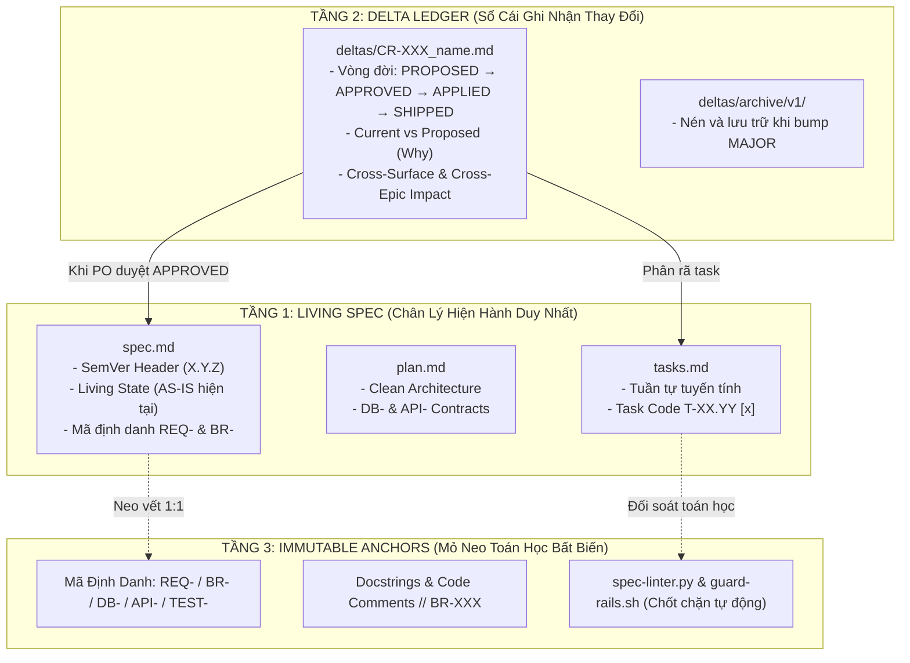

# HIẾN PHÁP QUẢN LÝ ĐẶC TẢ, VERSION & CHANGE REQUEST (CR)
## Mô Hình: 3 Tầng Bất Biến (Immutable Core) × Living Spec × Delta Ledger
*Phiên bản: 1.0.0 | Enterprise Standard | Đối tượng áp dụng: Toàn bộ thành viên và AI Agents (PO, BA, TechLead, Dev, QC, QA)*

---

> [!IMPORTANT]
> **HIỆU LỰC PHÁP LÝ TỐI CAO ĐỐI VỚI AI AGENTS & DEVELOPERS**:
> 1. Tài liệu này là **Hiến pháp chuẩn hóa duy nhất** về quản trị Đặc tả (Spec), Phiên bản (Version) và Yêu cầu Thay đổi (Change Request - CR) trong hệ sinh thái TC IT Agent.
> 2. Mọi AI Agent (Antigravity, Cursor, Windsurf, Claude Code...) và lập trình viên **BẮT BUỘC TUÂN THỦ 100%**.
> 3. Tuyệt đối cấm hành vi "Vibe Coding" không có mỏ neo: Không có mã định danh, không sửa spec mà tự ý gõ code, hoặc sửa đè thô bạo làm phá vỡ tính truy vết.

---



---

## 1. KIẾN TRÚC LƯU TRỮ SPEC: THEO TỪNG MODULE / EPIC (PER-EPIC SPECS)

Tuyệt đối **không dùng 1 file spec khổng lồ** (hàng chục nghìn dòng), vì LLM sẽ bị quá tải context window, gây hiện tượng ảo giác, cắt xén logic và trôi dạt kiến trúc.

### Cấu trúc thư mục chuẩn mực trong `specs/` (hoặc `SourceCode/specs/`):
```text
specs/
├── ROADMAP.md                            # Master Registry: Toàn bộ Epics, Trạng thái, Task count
├── TRACEABILITY.md                       # Ma trận truy vết khép kín: REQ ↔ BR ↔ DB ↔ UI ↔ API ↔ Test
├── EPIC-01_AUTHENTICATION_VA_RBAC/
│   ├── spec.md                           # Living Spec: Chân lý nghiệp vụ HIỆN HÀNH (As-Is State)
│   ├── plan.md                           # Thiết kế kỹ thuật, DB Schema, API Contracts
│   ├── tasks.md                          # Danh sách công việc phân rã tuần tự có checkbox [x]
│   └── deltas/                           # Sổ cái lịch sử các Change Request (CR)
│       ├── CR-2026-001_sso_google.md
│       ├── CR-2026-002_mfa_totp.md
│       └── archive/                      # Thư mục nén lưu trữ các CR của chu kỳ Major cũ
│           └── v1/
└── EPIC-02_CORE_BUSINESS/
    ├── spec.md
    ├── plan.md
    ├── tasks.md
    └── deltas/
```

---

## 2. QUY TRÌNH QUẢN LÝ VERSION: SEMVER CHO SPEC (SEMANTIC SPEC VERSIONING)

Áp dụng chuẩn đánh version ngữ nghĩa ngay tại Header của mỗi `spec.md`, `plan.md`, `tasks.md`:

- **`MAJOR (X.0.0)`**: Thay đổi lớn phá vỡ tính tương thích (Breaking Change) — Đổi luồng nghiệp vụ cốt lõi, xóa bỏ phân hệ cũ, tái cấu trúc bảng CSDL hạt nhân.
- **`MINOR (1.X.0)`**: Bổ sung tính năng mới, thêm luồng nghiệp vụ mới nhưng tương thích ngược (Non-breaking additive) — Thêm màn hình, thêm bảng mới, mở rộng API.
- **`PATCH (1.0.X)`**: Làm rõ câu chữ (Clarification), bổ sung validation rule, sửa lỗi biên góc khuất (Edge case fix), cập nhật test.

### Header Metadata Bắt Buộc ở đầu mỗi file Spec:
```markdown
# Feature Specification: [Mã Task / Epic] [Tên Tính Năng]

**Epic**: EPIC-01 Authentication & RBAC  
**Version**: 1.2.0  
**Status**: Shipped | In Implementation | In Review  
**Last Updated**: 2026-10-30  
**Baseline Hash / Commit**: abc123def  
**Ánh Xạ Kỹ Thuật**: Clean Architecture Modular Monolith  
```

---

## 3. VÒNG ĐỜI CHANGE REQUEST (DELTA LEDGER LIFECYCLE)

Mọi yêu cầu thay đổi (CR) không bao giờ được sửa đè ngay vào code hay sửa lén vào `spec.md`. Bắt buộc đi qua **Sổ Cái Delta Ledger** tại `specs/<epic-id>/deltas/CR-YYYY-XXX_<slug>.md`.

### 4 Trạng Thái Vòng Đời Của Một File Delta:
1. **`PROPOSED`**: Đề xuất sơ bộ từ User / Stakeholder / BA.
2. **`APPROVED`**: PO thẩm định và phê duyệt (Đã lập Cross-Surface Impact Matrix).
3. **`APPLIED` (hoặc `IMPLEMENTED`)**: Dev đã cập nhật vào `spec.md`, phân rã vào `tasks.md` và hoàn thành code.
4. **`SHIPPED` (hoặc `VERIFIED`)**: QC kiểm thử 4 tầng đạt 100% Pass và PO ký duyệt xuất xưởng Gate 5.

### Cấu Trúc Bắt Buộc Của File Delta (`CR-XXX.md`):
```markdown
# CHANGE REQUEST: [Mã CR] [Tên Yêu Cầu Thay Đổi]

- **Trạng thái**: PROPOSED | APPROVED | APPLIED | SHIPPED
- **Epic**: [Mã Epic liên quan]
- **Tác giả đề xuất**: [User / PO / BA]
- **Ngày phê duyệt**: [YYYY-MM-DD]
- **Phiên bản Spec áp dụng**: Version 1.X.0

---

## 1. BỐI CẢNH & LÝ DO THAY ĐỔI (WHY)
[Mô tả nguyên nhân nghiệp vụ hoặc phản hồi người dùng dẫn tới thay đổi này]

## 2. SO SÁNH HIỆN TRẠNG (CURRENT) VS ĐỀ XUẤT (PROPOSED)
| Hạng Mục | Hiện Trạng (As-Is / Current) | Đề Xuất Mới (To-Be / Proposed) | Lý Do Cụ Thể |
| :--- | :--- | :--- | :--- |
| **Giao diện (UI)** | ... | ... | ... |
| **Logic (BR-*)** | ... | ... | ... |
| **Dữ liệu (DB-*)** | ... | ... | ... |

## 3. MA TRẬN ẢNH HƯỞNG ĐA BỀ MẶT (CROSS-SURFACE IMPACT MATRIX)
- [ ] **Basic Design / Wireframe**: Cần sửa đổi màn hình nào?
- [ ] **Living Spec (spec.md)**: Cần thêm mới hay sửa quy tắc BR nào?
- [ ] **Database & Migrations**: Thêm cột, đổi kiểu dữ liệu hay tạo bảng mới?
- [ ] **API & DTO Contracts**: Breaking changes hay Non-breaking?
- [ ] **Frontend Pages & Components**: Sửa đổi component nào?
- [ ] **Test Suites**: Cần bổ sung test case nào cho Unit, DB, E2E?
```

---

## 4. MỎ NEO BẤT BIẾN (IMMUTABLE ANCHORS)

Tất cả các thành phần trong hệ thống bắt buộc phải được gắn mã định danh mỏ neo:
- **`REQ-XXX`**: Yêu cầu chức năng cấp cao (Functional Requirement).
- **`BR-XXX`**: Quy tắc nghiệp vụ chi tiết (Business Rule).
- **`DB-XXX`**: Bảng dữ liệu hoặc trường cốt lõi (Database Entity).
- **`API-XXX`**: Hợp đồng endpoint (API Route / Contract).
- **`UI-XXX`**: Màn hình hoặc Component giao diện (Interface Element).
- **`TEST-XXX`**: Kịch bản kiểm thử tương ứng (Automated Test Case).

### Quy Tắc Ghi Chú Mỏ Neo Trong Mã Nguồn:
Trong code Backend và Frontend, mọi logic nghiệp vụ bắt buộc phải có comment tham chiếu trực tiếp đến mã `BR-*`:
```typescript
// [BR-AUTH-01]: Khóa tài khoản sau 5 lần đăng nhập thất bại trong 15 phút
if (failedAttempts >= 5) {
    await lockAccount(user.id, Duration.fromMinutes(15));
}
```

> **Lợi ích**: Khi có CR sửa đổi `BR-AUTH-01`, AI chỉ cần chạy lệnh `grep -rn "BR-AUTH-01"` trên toàn bộ repo là định vị chính xác 100% vị trí cần can thiệp, không bỏ sót, không đoán mò.

---

## 5. CƠ CHẾ ĐÓNG GÓI & NÉN LƯU TRỮ (DELTA PRUNING & CONSOLIDATION)

Để tránh tình trạng thư mục `deltas/` bị phình to làm nghẽn context của LLM sau nhiều tháng phát triển:
1. **Chu kỳ Minor (`v1.1.0` $\rightarrow$ `v1.9.0`)**: Giữ nguyên các file `CR-XXX.md` trong `deltas/` để tra cứu lịch sử gần.
2. **Chu kỳ Major (`v2.0.0`)**:
   - Khi có nâng cấp kiến trúc lớn bump lên `v2.0.0`, toàn bộ các file `CR-XXX.md` thuộc thế hệ v1 được tự động di chuyển vào:
     `specs/<epic-id>/deltas/archive/v1/`
   - File `spec.md` được biên tập lại thành bản **Living Baseline v2.0.0** tinh gọn, mạch lạc.
   - Thư mục `deltas/` chỉ giữ lại các CR mới của chu kỳ v2.

---

## 6. PHÂN ĐỊNH RANH GIỚI SSOT GIỮA BASIC DESIGN VÀ LIVING SPEC

```text
┌─────────────────────────────────────────────────────────────────────────────┐
│ TẦNG VĨ MÔ: Basic Design (Kihon Sekkei)                                     │
│ - Nguồn chân lý duy nhất cho: C4 Architecture (Context & Container)        │
│ - Product Backbone, Walking Skeleton toàn hệ thống                          │
│ - Ma trận Vai trò & Luồng tương tác liên phân hệ                           │
│ - Design System chung: Typography, Color Palette, 5 UX States               │
└──────────────────────────────────────┬──────────────────────────────────────┘
                                       │ Ánh xạ phân rã 1:1
                                       ▼
┌─────────────────────────────────────────────────────────────────────────────┐
│ TẦNG VI MÔ: Living Spec (spec.md) trong specs/<epic-id>/                    │
│ - Nguồn chân lý duy nhất cho: Từng quy tắc nghiệp vụ chi tiết (BR-*)        │
│ - Hợp đồng API chi tiết (DTOs, Parameters, Status Codes)                    │
│ - Form fields, validation rules, error messages                             │
│ - Các đợt Change Request (CR) vi mô giải quyết trong nội bộ phân hệ         │
└─────────────────────────────────────────────────────────────────────────────┘
```

---

## 7. CHỐT CHẶN TỰ ĐỘNG BẰNG MÁY (ZERO-TRUST AUTOMATED ENFORCEMENT)

Hệ thống vận hành 2 chốt chặn toán học cưỡng chế:
1. **Script Kiểm Toán `spec-linter.py`** (`scripts/spec-linter.py`):
   - Tự động kiểm tra tính liên tục của Phase trong `tasks.md`.
   - Đối soát từng task `[x]` với `ROADMAP.md`.
   - Bắt lỗi trùng lặp Delta version, tiêu đề dị thường, lệch pha Status header.
2. **Chốt Chặn Git Hooks `guard-rails.sh`** (`scripts/guard-rails.sh`):
   - Tích hợp vào `pre-commit` và `pre-push` hooks.
   - Ngắt lệnh lập tức (exit 1) nếu phát hiện bất kỳ lỗi lộn xộn hoặc lệch pha nào.
   - Ngăn chặn triệt để cờ bypass (`--no-verify`, `-n`) qua `block-no-verify.py`.

---

## 8. TỔNG KẾT: "4 KHÔNG" BẤT KHẢ XÂM PHẠM

```text
1. KHÔNG SỬA CODE KHI SPEC CHƯA ĐỔI:
   Muốn sửa logic -> Soạn CR -> Sửa spec.md -> Phân rã task -> Mới được gõ code.

2. KHÔNG GHI ĐÈ LỊCH SỬ THÔ BẠO:
   spec.md luôn là bản As-Is sạch đẹp; lịch sử và căn cứ thay đổi lưu tại deltas/CR-XXX.md.

3. KHÔNG DÙNG SPEC KHÔNG CÓ MÃ ĐỊNH DANH:
   100% logic phải có mỏ neo bất biến: REQ-*, BR-*, DB-*, API-*, UI-*, TEST-*.

4. KHÔNG ĐỂ QUY TRÌNH NẰM TRÊN GIẤY:
   Mọi quy tắc phải được kiểm chứng bằng script tự động (spec-linter.py, guard-rails.sh).
```
