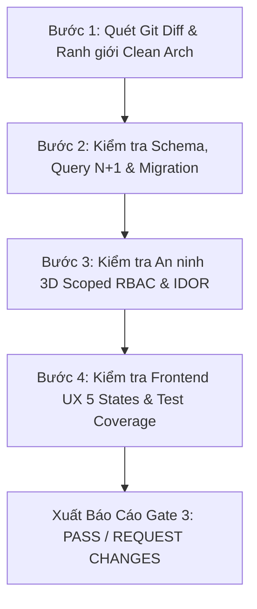

# Task & Pull Request Review Guardian (`pr-review-guard`)

Skill chuyên trách dành cho **Agent TechLead / SA** và **Senior Developers** để bảo đảm chất lượng mã nguồn trước khi tích hợp vào nhánh chính.

---

## 1. KHI NÀO SỬ DỤNG
1. **Developer trước khi tạo PR hoặc trước khi gạt `[x]` trong `tasks.md`**: Kích hoạt để tự kiểm tra (Self-Review) xem mã nguồn đã đạt Task Definition of Done (DoD) hay chưa.
2. **TechLead / SA khi review PR (Gate 3 Approval)**: Kích hoạt để rà soát đối kháng (Adversarial Review) trên Diff của Pull Request theo 6 trục kiểm soát.
3. **Trước khi bàn giao sang QC (Gate 4)**: Đảm bảo không có lỗi kiến trúc, lỗi N+1 hay lỗ hổng bảo mật sơ đẳng lọt sang đội kiểm thử.

---

## 2. QUY TRÌNH 4 BƯỚC RÀ SOÁT TỰ ĐỘNG

Khi chạy `/pr-review-guard` hoặc rà soát một PR / Task:



### Bước 1: Quét Ranh giới Kiến trúc (Clean Architecture Boundary)
- Quét các file thay đổi trong PR:
  - Nếu có `using Microsoft.EntityFrameworkCore;` hoặc `using NacenTwin.Infrastructure;` trong thư mục `Domain/` $\rightarrow$ **FLAG VIOLATION**.
  - Nếu có inject trực tiếp `AppDbContext` vào `Controllers/` hoặc `Endpoints/` $\rightarrow$ **FLAG VIOLATION** (Bắt buộc dùng `ISender` / `IMediator`).
  - Kiểm tra xem Command/Query có trả về Entity thô thay vì DTO không.

### Bước 2: Thẩm định CSDL, EF Core & Migration
- Nếu PR có file Migration mới trong `Infrastructure/Data/Migrations/`:
  - Kiểm tra xem có lệnh `DropColumn`, `RenameColumn`, `AlterColumn` làm mất dữ liệu không $\rightarrow$ Nếu có, cảnh báo vi phạm **Migration phi phá hủy**.
  - Cột mới thêm bắt buộc có `defaultValue` hoặc `.IsRequired(false)`.
- Quét các câu truy vấn LINQ:
  - Có gọi truy vấn CSDL trong vòng lặp `foreach` không (Lỗi N+1 query).
  - Queries có dùng `.AsNoTracking()` không.
  - Các bảng trạng thái quan trọng có Concurrency Token (Optimistic Locking) không.

### Bước 3: Thẩm định An ninh & 3D Scoped RBAC
- Với mỗi endpoint mới trong WebAPI:
  - Có gắn attribute `[Authorize]` hoặc Policy phân quyền không?
  - Có kiểm tra `Role` (Ai), `Scope` (Tenant/Chi nhánh), `Action` (Quyền thao tác) không?
  - Có lỗ hổng IDOR không? (Truy vấn theo Id bắt buộc kèm điều kiện `TenantId` / `UserId` sở hữu).
  - Endpoint upload file: Đã có kiểm tra Magic Bytes thực tế chưa, hay chỉ tin `file.ContentType`?

### Bước 4: Thẩm định Frontend, Độ Bền Tương Tác & Độ phủ Kiểm thử
- Với code Frontend (React / Zalo Mini App):
  - Component tải dữ liệu có bọc đủ 5 trạng thái UX qua `<Async>` không (`Loading`, `Empty`, `Error`, `Success`, `Partial`)?
  - Có nút bấm nào bị thiếu xử lý disable chống Double-click khi submit không?
  - Có hardcode dữ liệu tĩnh trong file trang thay vì dùng hook `useMasterData()` không?
  - **Kiểm soát Gián đoạn & Dọn dẹp State (Interrupt & Cleanup Robustness)**:
    + Các hàm gọi API/custom hooks có truyền `signal: abortController.signal` để hủy request khi unmount component không?
    + Các effect có trả về cleanup function không, tránh rò rỉ bộ nhớ hoặc setState trên unmounted component?
    + Form nhập liệu có cảnh báo khi người dùng rời trang lúc form đang có dữ liệu bẩn (`isDirty`) không?
- Với Test Coverage:
  - Đã có Unit Test bao phủ 100% các quy tắc `BR-*` trong spec chưa?
  - Có test assertion hình thức (`Assert.NotNull`, `toBeInTheDocument()`, `is_visible()`) mà không assert giá trị thật hoặc không test hành vi click/submit/navigation không? $\rightarrow$ Nếu có, **REQUEST CHANGES NGAY LẬP TỨC**.
  - Đã đối soát 1:1 với HTML Wireframe Basic Design gốc để đảm bảo không bị cắt xén controls/tabs/filters chưa?

---

## 3. ĐỊNH DẠNG BÁO CÁO KẾT QUẢ REVIEW (GATE 3 VERDICT)

Sau khi hoàn tất rà soát, Agent xuất báo cáo chuẩn:

```markdown
### 🛡️ KẾT QUẢ THẨM ĐỊNH PR & TASK (GATE 3 AUDIT REPORT)
- **PR / Task**: [Tên Task hoặc Branch]
- **Reviewer**: TechLead / SA (Adversarial Mode)
- **Kết luận**: [✅ APPROVED / ⚠️ REQUEST CHANGES / ❌ REJECTED]

#### 1. Đánh giá 6 Trục Kiểm Soát:
- [x] Trục 1: Clean Architecture Boundary: ĐẠT
- [x] Trục 2: CSDL & Migration Phi Phá Hủy: ĐẠT
- [x] Trục 3: An ninh 3D Scoped RBAC & Anti-IDOR: ĐẠT
- [x] Trục 4: Concurrency & Idempotency: ĐẠT
- [x] Trục 5: Frontend 5 UX States & Responsive: ĐẠT
- [x] Trục 6: Unit Test BR-* & Test Evidence: ĐẠT

#### 2. Chi tiết vấn đề cần sửa (nếu Request Changes):
1. **[Lỗi / Cảnh báo]**: Tại file `src/WebAPI/Controllers/ExpertController.cs`, dòng 45: Đang inject trực tiếp `AppDbContext`. Cần chuyển sang gửi MediatR Query.
2. ...

#### 3. Điều kiện để Merge:
- [ ] Fix toàn bộ các điểm trên.
- [ ] Re-run `dotnet test` && `pnpm test` pass 100%.
- [ ] Chuyển tiếp sang QC Specialist chạy kiểm thử Gate 4.
```
