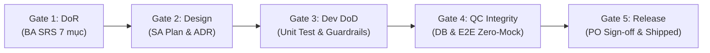

# Kỹ Năng: QA Stage-Gate Audit (Kiểm Toán 5 Cổng Chất Lượng Độc Lập)

## Mục Đích
Thẩm định và cấp thẻ thông hành (Pass/Fail) cho các mốc chuyển giao giữa các Agent trong chu trình phát triển phần mềm doanh nghiệp, bảo đảm không có tình trạng làm ẩu, đốt cháy giai đoạn hoặc vi phạm Definition of Ready / Definition of Done.

## Ma Trận Kiểm Toán 5 Cổng (5-Stage Gate Matrix)

---

### Gate 1: Yêu Cầu & Đặc Tả (DoR Audit)
- **Tác tử thực thi**: BA (`ba`), Phê duyệt: PO (`po-pm`), Kiểm toán: QA (`qa`).
- **Điều kiện kiểm toán**:
  - Tài liệu SRS tại `specs/[epic-id]/spec.md` đã hoàn tất đủ 7 mục chuẩn.
  - Mã định danh khép kín: 100% `REQ-*`, `BR-*`, `DB-*` rõ ràng, không mâu thuẫn.
  - Không có giả định phỏng đoán (`[UNVERIFIED]` phải được làm rõ qua `ba-clarify`).
  - Đạt Definition of Ready (DoR) mới cho phép chuyển sang SA lập kế hoạch.

---

### Gate 2: Thiết Kế Kiến Trúc (Architecture & Consistency Audit)
- **Tác tử thực thi**: SA (`techlead-sa`), Kiểm toán: QA (`qa`).
- **Điều kiện kiểm toán**:
  - Đã có `specs/[epic-id]/plan.md` kèm File Manifest và phân tầng Clean Architecture.
  - Đã có `specs/[epic-id]/tasks.md` phân rã công việc tuần tự kèm kiểm chứng `[ ]` và đủ 5 hành vi Entity Lifecycle (`[FE-LIST]`, `[FE-DETAIL]`, `[FE-CREATE]`, `[FE-EDIT]`, `[FE-STATUS]`).
  - 100% `REQ-*` có API/Schema tương ứng.
  - Các quyết định kiến trúc đã chốt ADR trong `docs/decisions/`.
  - Không rò rỉ DbContext/CSDL lên Presentation/API. Chạy `sa-analyze` đạt 100% nhất quán chéo.

---

### Gate 3: Lập Trình & Code Quality (Dev DoD & Adversarial Review)
- **Tác tử thực thi**: Dev (`dev`), Review đối kháng: SA (`techlead-sa`), Kiểm toán: QA (`qa`).
- **Điều kiện kiểm toán**:
  - Chạy `./scripts/guard-rails.sh`: 0 lỗi biên dịch, 0 TypeScript error, pass Clean Architecture check.
  - Chạy `audit_wireframe_fields.py`: Tỷ lệ controls trên giao diện so với Wireframe HTML gốc $\ge 80\%$.
  - 100% quy tắc nghiệp vụ `BR-*` có Unit Test tương ứng và pass 100%.
  - Zero-Mock trong code: Tuyệt đối không dùng mảng tĩnh fix cứng thay API, không để fallback data giả trong khối `catch`.
  - Rà soát 6 trục kiểm soát qua `pr-review-guard`: 0 lỗi `CRITICAL`.

---

### Gate 4: Thẩm Định Kiểm Thử QC (QC Integrity & Zero-Mock Audit)
- **Tác tử thực thi**: QC (`ec`), Kiểm toán độc lập: QA (`qa`).
- **Điều kiện kiểm toán**:
  - **Pure Black-Box Testing**: QC kiểm thử hộp đen hoàn toàn, không dựa vào mock API.
  - **Zero-Mock trong Test**: Tuyệt đối không dùng `page.route()` mớm dữ liệu, không inject token giả.
  - **Deep DB State Verification**: Mọi thao tác Mutation phải được đối soát trực tiếp trong CSDL thật (dữ liệu được INSERT/UPDATE chính xác, không rỗng ruột).
  - **Zero-Shallow Assertions**: 100% nút bấm, link, search form có test hành vi click/submit/router thật.
  - Độ phủ bề mặt (Surface Coverage): 100% User Stories và Routes đều có test case. 0 lỗi Blocker/Critical/Major.

---

### Gate 5: Nghiệm Thu Xuất Xưởng (Go / No-Go Decision & Shipped)
- **Tác tử thực thi**: PO/PM (`po-pm`), Thẩm định độc lập: QA (`qa`).
- **Điều kiện kiểm toán**:
  - Kiểm tra toàn bộ checklist Definition of Done (`xong`).
  - Cập nhật Living Docs tại `docs/system/` phản ánh chính xác hiện trạng hệ thống.
  - Cập nhật Master Roadmap tại `specs/ROADMAP.md` sang trạng thái `[SHIPPED]`.
  - QA xuất bản Release Readiness Scorecard, cấp thẻ **[GO]** cho PO trước khi merge code hoặc release production.
