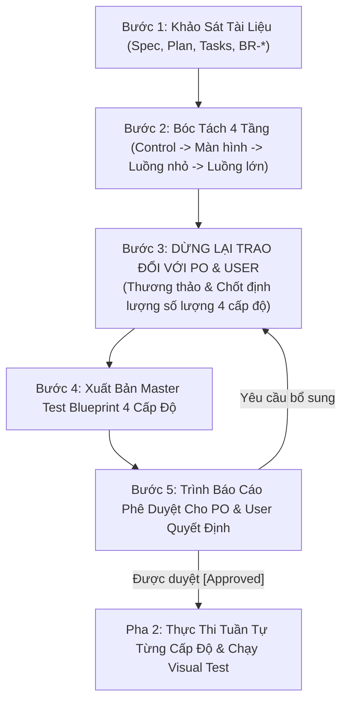

# Quy Trình Study Nghiệp Vụ & Thiết Kế Kịch Bản Kiểm Thử 4 Cấp Độ (nacen-qc-study)

> **Hiến chương bắt buộc**: Mỗi khi tiếp nhận kiểm thử một Epic hoặc Chức năng bất kỳ trong hệ sinh thái Enterprise, Ban QC **tuyệt đối không được nhảy vào code test ngay** hay chỉ test luồng lớn mà bỏ quên các chi tiết vi mô. Bắt buộc phải triển khai theo **Mô hình Kim tự tháp 4 Cấp Độ Kiểm Thử**, mở phiên trao đổi thống nhất số lượng với PO và Product Leader (User), sau đó mới đi vào thực thi tuần tự từng cấp độ.

---

## 1. NGUYÊN TẮC BẤT BIẾN (CORE RULES)

1. **Bản Sắc QC Hộp Đen Thuần Túy Nghiệp Vụ (Pure Black-Box Testing - Tuyệt Đối Không Đọc Code Để Viết Test)**:
   - **Đóng vai người dùng/nghiệp vụ mù về code**: QC không được biết gì về code backend/frontend, không biết hệ thống dùng mock hay không. QC tiếp cận hệ thống với tâm thế: *Nghiệp vụ đã bàn giao là chức năng đã hoàn thành*.
   - **Tuyệt đối cấm đọc code để viết test**: Nếu QC đọc code rồi viết test theo logic code đang có, hoặc tự mock API theo kịch bản màu hồng, thì bộ test trở nên vô nghĩa ("vừa đá bóng vừa thổi còi"). QC chỉ đọc và căn cứ duy nhất vào **Tài liệu Nghiệp vụ (Spec, Basic Design, BR-*)** để dựng kịch bản.
   - **Kiểm thử trên dữ liệu & môi trường thật (Real Data & Real Services)**: Mọi dữ liệu kiểm thử phải là dữ liệu thật phản ánh thực tế người dùng (tài khoản thật, input thật, phản hồi thật từ hệ thống). Không tự biên tự diễn mock dữ liệu để làm đẹp báo cáo.
2. **Kỷ Luật Định Nghĩa Rõ Ràng Điều Kiện PASS / FAIL Cho Từng Case**:
   - Mọi test case và luồng đều phải quy định tường minh:
     - **Điều kiện PASS**: Phải thỏa mãn đúng mong đợi nghiệp vụ (Form chặn đúng lỗi tiếng Việt, không lọt request, điều hướng đúng portal, quyền hạn cách ly tuyệt đối).
     - **Điều kiện FAIL (Phát hiện Bug)**: Bất kỳ hành vi lọt lỗi (bỏ trống mà vẫn submit được), lệch câu thông báo, văng mã lỗi kỹ thuật 500/English, vỡ layout, hoặc truy cập trái phép mà không bị chặn 403 đều bị lập biên bản `DEFECT REPORT`.
3. **Kỷ Luật 4 Cấp Độ Kiểm Thử Bắt Buộc (Mandatory 4-Level Testing Pyramid)**:
   * **Cấp độ 1 (Level 1 - Control & Field Validations)**: Kiểm soát vi mô từng control/input (Bỏ trống trường bắt buộc, sai định dạng regex email/phone, điều kiện biên độ dài min/max, mật khẩu không khớp, chưa tick cam kết PDPD Nghị định 13, kiểm tra trùng lặp email/MST...).
   * **Cấp độ 2 (Level 2 - Screen & Component Interactions)**: Kiểm thử tương tác cục bộ trên từng màn hình (Chuyển Tabs, mở Pane chi tiết, thao tác Thêm/Xóa danh sách động, 5 trạng thái UX: Loading Skeleton, Empty State, Error Alert, Success Toast, Updating).
   * **Cấp độ 3 (Level 3 - Sub-Workflows)**: Kiểm thử các luồng nghiệp vụ con (Kích hoạt tài khoản, Đăng xuất 2 bước xóa session, Gửi duyệt hồ sơ v1, Cán bộ từ chối có lý do $\ge 10$ ký tự theo `BR-ADM-004`, Cán bộ duyệt cấp quyền Maker-Checker, Optimistic Lock 409 khi tranh chấp duyệt).
   * **Cấp độ 4 (Level 4 - End-to-End User Journeys)**: Kiểm thử hành trình người dùng toàn trình (Vòng đời nâng cấp tài khoản từ đại chúng lên chuyên gia/doanh nghiệp, điều hướng động 10 Platform Roles qua Dynamic Gateway, Bảo mật RoleGuard và Scoped Row-Level Security chặn vượt cấp).
4. **Kỷ Luật Dừng Lại Trao Đổi Cụ Thể (Mandatory Negotiation - Cấm Tự Ý Làm Một Mình)**:
   * Trước khi viết kịch bản, **QC bắt buộc phải dừng lại**, mở phiên trao đổi trực tiếp với **PO và Product Leader (User)** để thương thảo định lượng:
     - Cấp 1 dự kiến bao nhiêu test case? Cấp 2 bao nhiêu? Cấp 3 bao nhiêu? Cấp 4 bao nhiêu?
     - Đã bao phủ hết các vai trò tham gia và các điểm mù chưa?
     - Chỉ khi cả 3 bên thống nhất về số lượng, QC mới được hoàn thiện Master Test Blueprint.
5. **Cổng Phê Duyệt Kịch Bản (Sign-off Gate)**: Xuất bản Master Blueprint 4 Cấp Độ trình PO và User. **Chỉ khi User bấm DUYỆT (APPROVED) thì QC mới được chuyển sang Pha 2 (Thực thi)**.

---

## 2. QUY TRÌNH 5 BƯỚC STUDY CỦA QC (PHA 1)

### Bước 1: Khảo sát Tài liệu, Living Specs & Kiểm Toán Bề Mặt (Surface Audit)
QC rà soát:
* `SourceCode/specs/<epic-id>/spec.md` (Toàn bộ User Stories US-01 đến US-n, Acceptance Criteria, BR-*).
* `SourceCode/specs/<epic-id>/plan.md` (API Contracts, DB Schema, UX States, URL Routes).
* `Specification/02_BASIC_DESIGN/<task-id>/README.md` (Gốc nghiệp vụ từ PO).

> [!IMPORTANT]
> **BẮT BUỘC LẬP BẢNG KIỂM KÊ BỀ MẶT (SURFACE & ROUTE INVENTORY MATRIX)**:
> QC phải liệt kê toàn bộ các Route/Giao diện của Epic:
> - Public Routes (Người ngoài/Doanh nghiệp xem, vd: `/experts/[code]`).
> - Owner Workspace Routes (Không gian cá nhân của chủ thể, vd: `/portal/expert/profile`).
> - Portal Dashboard Routes (Trang điều hành tác nghiệp, vd: `/portal`).
> - Intake & Onboarding Routes (Kênh tiếp nhận/nâng hạng, vd: `/profile/upgrade/*`, Zalo Mini App).
> - Admin Governance Routes (Hàng đợi thẩm định, vd: `/admin/approvals`).
>
> ❌ **CẤM TẦM NHÌN ĐƯỜNG HẦM**: Tuyệt đối không chỉ cắm đầu vào Form đăng ký/nâng hạng mà bỏ sót các trang hiển thị, dashboard, hoặc trang chi tiết công khai!

### Bước 2: Bóc tách 4 Cấp độ Kiểm thử Phủ Kín Mọi Bề Mặt
1. **Bóc tách Controls (Cấp 1)**: Lập danh sách từng trường nhập liệu trên form, các rule validation (Required, Min/Max, Regex, Cross-field, Duplicate).
2. **Bóc tách Màn hình (Cấp 2)**: Các tab, bộ lọc, modal, bảng dữ liệu, và 5 trạng thái UX (Loading, Empty, Error, Success) trên **TẤT CẢ các Bề mặt đã kiểm kê ở Bước 1**.
3. **Bóc tách Luồng con (Cấp 3)**: Các nghiệp vụ tương tác nội bộ giữa các trạng thái dữ liệu (Review, Reject có lý do, Logout, 409 conflict, Khóa sửa khi Pending).
4. **Bóc tách Luồng lớn (Cấp 4)**: Ma trận vai trò, vòng đời tài khoản, luồng chuyển đổi quyền, điều hướng động và phân quyền Scoped RBAC (Cross-Owner Isolation).

### Bước 3: DỪNG LẠI TRAO ĐỔI VỚI PO VÀ USER (Thương Thảo Số Lượng & Đối Soát Bề Mặt)
> **KỶ LUẬT TUYỆT ĐỐI**: Cấm QC tự ý quyết định danh sách kịch bản một mình rồi âm thầm làm.

QC dừng lại mở phiên trao đổi cụ thể với PO và User:
* *"Báo cáo PO và Anh: Với Epic [Tên Epic], QC đã kiểm kê đủ [M] Bề mặt giao diện và đối soát [K] User Stories. QC đề xuất định lượng kiểm thử 4 cấp độ gồm: Cấp 1 có [A] cases, Cấp 2 có [B] cases, Cấp 3 có [C] cases, Cấp 4 có [D] cases. Tổng cộng là [N] cases bao phủ 100% bề mặt. Xin ý kiến PO và Anh về số lượng và độ phủ này đã đầy đủ hay chưa?"*

### Bước 4: Xuất Bản Master Test Blueprint 4 Cấp Độ
QC xuất bản bảng tài liệu chuẩn theo đúng định dạng 4 Cấp độ:
- Bảng Cấp độ 1: Mã test `TC-C1-*` (Control, Input, Thao tác, Kết quả kỳ vọng).
- Bảng Cấp độ 2: Mã test `TC-C2-*` (Màn hình, Tương tác, Trạng thái UX, Kết quả).
- Bảng Cấp độ 3: Mã test `TC-C3-*` (Sub-workflow, Tác nhân, Các bước nghiệp vụ, Kết quả).
- Bảng Cấp độ 4: Mã test `TC-C4-*` (Actor, E2E Journey, Các điểm chạm, Kết quả nghiệm thu).

### Bước 5: Trình Ký Duyệt Cổng Kịch Bản (Scenario Sign-off Gate)
Chỉ chuyển sang Pha 2 khi có phê duyệt chính thức từ PO và User.

---

## 3. PHA 2: THỰC THI CHI TIẾT TUẦN TỰ 4 CẤP ĐỘ

Sau khi được phê duyệt, QC tiến hành thực thi theo đúng thứ tự từ đáy kim tự tháp lên đỉnh:
1. **Thực thi Cấp độ 1 (Control Validations)**: Viết kịch bản kiểm tra từng control rỗng, sai format, sai pass, duplicate $\rightarrow$ Verify pass 100%.
2. **Thực thi Cấp độ 2 (Screen Interactions)**: Kiểm tra chuyển tabs, mở review pane, kiểm chứng 5 trạng thái UX qua `<Async>` component $\rightarrow$ Verify pass 100%.
3. **Thực thi Cấp độ 3 (Sub-Workflows)**: Kiểm thử luồng từ chối có lý do, Maker-Checker, Optimistic Lock 409, Logout an toàn xóa token $\rightarrow$ Verify pass 100%.
4. **Thực thi Cấp độ 4 (E2E Journeys)**: Kiểm thử toàn trình đăng nhập 10 Roles, luồng nâng cấp hồ sơ, RoleGuard bảo mật $\rightarrow$ Mở Chromium thật chạy chậm (`slow_mo`) trên màn hình để PO/User nghiệm thu trực quan.
5. **Ký biên bản nghiệm thu Gate 4**: Báo cáo kết quả tổng hợp 4 cấp độ gửi PO/PM ký xuất xưởng Gate 5.
